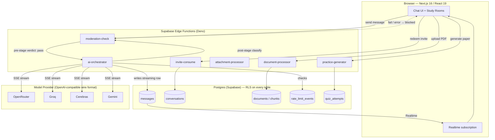

<div align="center">


[](https://github.com/Crusty-chirayu/AARAGATE)

<p>
  
  
  
  
  <br/>
  
  
  
  
</p>

<p>
  
  
  
  
</p>

**[Live Demo](#) · [Report Bug](https://github.com/Crusty-chirayu/AARAGATE/issues) · [Request Feature](https://github.com/Crusty-chirayu/AARAGATE/issues)**

</div>

<br/>

> **A note before you read further.** This README describes AARAGATE exactly as the codebase implements it — every number, limit, and file path below was pulled from the actual repo (migrations, Edge Functions, rate-limit config, motion tokens), not guessed. Where something is a design intent rather than a shipped behavior, it's labeled as such.

<br/>

## Table of Contents

- [What is AARAGATE](#what-is-aaragate)
- [Feature Tour](#feature-tour)
- [How It's Put Together](#how-its-put-together)
- [The AI Pipeline](#the-ai-pipeline)
- [Practice Papers & Scoring](#practice-papers--scoring)
- [Security Model](#security-model)
- [Rate Limits](#rate-limits)
- [Motion System](#motion-system)
- [Tech Stack](#tech-stack)
- [Project Structure](#project-structure)
- [Plans](#plans)
- [Getting Started](#getting-started)
- [Testing](#testing)
- [Docs Index](#docs-index)
- [Contributing](#contributing)
- [Star History](#star-history)

<br/>

## What is AARAGATE

AARAGATE is two products sharing one conversation engine: a **1:1 AI tutor** for the moment a doubt won't wait, and **batch study rooms** where a group preps together with the same tutor sitting in on mention.

Every reply streams token-by-token into a Postgres row everyone in the room is subscribed to — there's no "refresh to see the new message," because the row *is* the message, updating live for every member at once.

<br/>

## Feature Tour

| | |
|---|---|
| 🤖 **A tutor for the 2 a.m. doubt** | A private thread with an assistant that re-derives, re-explains three ways, or generates five more like it. Streams as it's generated; stop and regenerate mid-flight. |
| 📣 **A tutor with manners** | Rooms pick their own posture — off, mention-only, or always-on. In mention-only, it waits for `@ai` instead of hijacking the discussion. |
| 👥 **Study rooms that hold a batch together** | Invite by link, roles for owner/admin/member, presence, typing indicators, reactions, and a per-room topic that tells the tutor what the batch is preparing for. |
| 🛡️ **Moderation that fails closed** | Every message is classified *before* it reaches the model and *again* before an answer is published. If the classifier errors, nothing ships. |
| 📊 **Limits you can see** | Fixed-window rate limits per user, persisted in Postgres — no surprise throttling mid-revision. |
| ⚡ **Realtime by default** | The tutor's reply is one row that updates as it streams — everyone in the room watches the same derivation appear at the same moment. |
| 📄 **PDF-grounded practice** | Upload a study PDF, read its extracted text, and generate validated practice questions from its private, owner-scoped chunks. |
| 📝 **GATE-style practice papers** | Generate MCQ / MSQ / NAT question sets from a topic or a document, scored exactly to GATE's own negative-marking rules. |
| 📌 **Pinned chats & read receipts** | Pin the room that matters; see who in a group has actually read a message. |
| 📤 **Your data, exportable** | History is yours — search it, export it. Training on your conversations is opt-in and off by default. |

<br/>

## How It's Put Together



The provider key **never reaches the browser** — it lives only inside `ai-orchestrator`, read from a Supabase secret at request time. The client receives a stream; it never sees a credential.

<br/>

## The AI Pipeline

`ai-orchestrator` is the only Edge Function that holds a provider key. It talks to every provider — OpenRouter, Groq, Cerebras, and Google Gemini (via its OpenAI-compatible layer) — through **one** request builder and **one** SSE parser, because all four expose the same Chat Completions wire format. Switching providers is a secret + an `AI_PROVIDER` env change, not a new code path.

```ts
export type ProviderId = "openrouter" | "groq" | "cerebras" | "gemini";
```

| Provider | Default model | Selected via |
|---|---|---|
| OpenRouter *(default)* | `anthropic/claude-sonnet-4.6` | `AI_PROVIDER=openrouter` |
| Groq | `llama-3.3-70b-versatile` | `AI_PROVIDER=groq` |
| Cerebras | `llama-3.3-70b` | `AI_PROVIDER=cerebras` |
| Gemini | `gemini-2.5-flash` | `AI_PROVIDER=gemini` |

The parser handles the ugly real-world edges of provider streams on purpose — OpenRouter's `: OPENROUTER PROCESSING` keep-alive comment lines are skipped before anything is handed to `JSON.parse`, mid-stream errors arriving as ordinary `data:` frames are surfaced instead of swallowed, and the final usage-accounting frame is read before the `data: [DONE]` sentinel closes the stream.

Every message runs the same **fail-closed** moderation twice — once as the user's own draft (`pre`), once on the model's answer before it's published (`post`). If the classifier itself errors, the message is blocked, not passed through — a broken moderator is treated as a "no," never a "maybe."

<br/>

## Practice Papers & Scoring

`practice-generator` turns a topic (or an uploaded document) into a validated set of GATE-style questions, and it is deliberately strict about what it accepts back from the model:

> *It deliberately does not repair model output. A generated question whose key is missing, whose answer id is not among its options, or whose NAT range is inverted is unusable — quietly coercing one would hand a student a question that cannot be scored correctly.*

Scoring follows GATE's own rules exactly, computed server-side so the client can never influence its own grade:

| Kind | Unanswered | Correct | Wrong |
|---|---|---|---|
| **MCQ** | 0 | `+marks` | `−marks⁄3` (negative) |
| **MSQ** | 0 | `+marks` (exact set match) | `0` (no negative) |
| **NAT** | 0 | `+marks` (inside inclusive range) | `0` (no negative) |

An unanswered question is always `0` — never negative — so leaving something blank is never worse than a wrong guess, matching the actual exam's incentive structure. MSQ is all-or-nothing: a partial selection scores zero, exactly as GATE grades it.

Every AI-generated question carries a required provenance label and is never presented as an official GATE question or as grounded in a document unless a real document reference actually backs it.

<br/>

## Security Model

| | |
|---|---|
| 🔑 **The provider key never reaches a browser** | All model calls run inside an Edge Function. The client gets a stream, never a credential. |
| 🗄️ **Row Level Security on every table** | Membership is the boundary. Audit tables have RLS enabled with **zero** policies — unreachable from the `anon` and `authenticated` roles entirely. |
| 📄 **Study PDFs stay private to their owner** | Uploaded documents and extracted chunks are owner-scoped; extracted text can be read in Documents or used to generate practice questions. |
| 🎚️ **Opt-in training, off by default** | Conversations aren't training data unless you say so, revocable in Settings at any time. |

As of this README, the migrations ship **46 `CREATE POLICY` statements** across 7 migration files, and `invite-consume` runs with `service_role` specifically because a client redeeming an invite has, by definition, no RLS path to a room it isn't a member of yet.

<br/>

## Rate Limits

Fixed-window counters, persisted in a `rate_limit_events` table — not in-memory, so they survive a cold Edge Function start.

| Bucket | Limit | Window |
|---|---|---|
| `messages_per_min` | 30 | 60s |
| `ai_invocations_per_min` | 10 | 60s |
| `invites_per_hour` | 20 | 3600s |
| `moderation_checks_per_min` | 60 | 60s |

`moderation-check` is exposed as its own endpoint (reachable with nothing but a valid session) so the client can pre-flight text without ever touching the provider key — and it's rate-limited on its own bucket precisely because each call can hit a paid upstream classifier.

<br/>

## Motion System

Every animated component pulls its timings from one token file — no ad hoc per-component values — and the rule is simple: **animate `transform` / `opacity` only, never `width` / `height` / `top` / `left`.**

```ts
export const DURATION = {
  micro: 0.12,    // hover / press
  standard: 0.2,  // most transitions
  emphasis: 0.32, // modals, page transitions
  hero: 0.48,     // landing only
} as const;

export const EASE = {
  enter: [0.16, 1, 0.3, 1],  // ease-out-expo — anything ENTERING
  exit:  [0.7, 0, 0.84, 0],  // anything EXITING
};
```

<br/>

## Tech Stack

<table>
<tr><td><b>Framework</b></td><td>

  

</td></tr>
<tr><td><b>Backend</b></td><td>

  

</td></tr>
<tr><td><b>Validation</b></td><td>

 

</td></tr>
<tr><td><b>UI & Motion</b></td><td>

   

</td></tr>
<tr><td><b>Testing</b></td><td>

  

</td></tr>
</table>

**33 unit/integration test files**, **15 Playwright e2e specs** (including a dedicated accessibility suite and a contrast checker over 34 color pairs), plus a standalone Deno test for the fail-closed moderation contract.

<br/>

## Project Structure

```
AARAGATE/
├─ src/
│  ├─ app/                     # Next.js App Router
│  │  ├─ app/                  #   the authenticated product
│  │  │  ├─ c/                 #     chat / conversation view
│  │  │  ├─ practice/          #     practice paper generation + attempts
│  │  │  ├─ attempts/          #     scored attempt history
│  │  │  ├─ documents/         #     uploaded documents (RAG source)
│  │  │  ├─ analysis/          #     performance analysis
│  │  │  └─ settings/
│  │  ├─ login / signup / auth #   auth flows (incl. OAuth callback)
│  │  ├─ join/[code]/          #   invite redemption
│  │  ├─ onboarding/, pricing/, changelog/
│  │  └─ page.tsx              #   marketing landing page
│  ├─ components/              # UI, landing sections, chat, rooms
│  └─ lib/                     # pure, testable domain logic
│     ├─ motion.ts             #   shared animation tokens
│     ├─ practice.ts, quiz.ts  #   question generation + scoring contracts
│     ├─ citations.ts, context-selection.ts  # RAG grounding
│     ├─ read-receipts.ts, attempts.ts, pricing.ts, data-export.ts
│     └─ data/                 #   real vs. DEMO_MODE data layer
├─ supabase/
│  ├─ functions/               # Deno Edge Functions
│  │  ├─ ai-orchestrator/      #   the only place a provider key exists
│  │  ├─ moderation-check/     #   standalone pre/post classifier
│  │  ├─ document-processor/   #   PDF → text → chunks → embeddings
│  │  ├─ attachment-processor/ #   legacy message attachment processing
│  │  ├─ practice-generator/   #   topic/document → scored question set
│  │  ├─ invite-consume/       #   server-side invite redemption
│  │  └─ _shared/              #   cors, ratelimit, moderation, provider
│  └─ migrations/              # 7 migrations, 46 RLS policies
├─ e2e/                        # Playwright specs (incl. a11y, perf, offline)
├─ tests/                      # Vitest unit/integration suites
├─ load/k6/                    # load testing
├─ docs/                       # implementation notes, audits, checkpoints
├─ AGENTS.md · ACCEPTANCE.md · AUDIT.md · SECURITY.md · RELEASING.md
└─ scripts/                    # contrast checker, favicon gen, setup checks
```

<br/>

## Plans

| | Free | Pro | Campus |
|---|:---:|:---:|:---:|
| **Price** | $0 forever | $4/mo | Custom |
| 1:1 AI tutor chat | Unlimited | Unlimited | Unlimited |
| Study rooms | 3 | Unlimited | Batch-sized |
| Message history | 30 days | Full + global search | Full |
| Study PDFs | — | ✅ | ✅ |
| Model access | Standard | Priority | Priority |
| Admin-managed membership | — | — | ✅ |

<br/>

## Getting Started

```bash
git clone https://github.com/Crusty-chirayu/AARAGATE.git
cd AARAGATE
npm install
cp .env.example .env.local
npm run dev
```

With **no** Supabase variables set, the app boots straight into **DEMO MODE** — an in-browser store with a simulated streaming assistant, so the full UI is explorable with zero backend setup.

To run the real backend, fill in `.env.local`:

```bash
NEXT_PUBLIC_SUPABASE_URL=
NEXT_PUBLIC_SUPABASE_ANON_KEY=
```

...and set the server-side secrets via the Supabase CLI (never in `.env.local`):

```bash
supabase secrets set OPENROUTER_API_KEY=sk-or-...
# or GROQ_API_KEY / CEREBRAS_API_KEY / GEMINI_API_KEY, matching AI_PROVIDER
```

<br/>

## Testing

```bash
npm run test           # Vitest — unit & integration
npm run test:a11y      # accessibility suite (axe-core)
npm run test:contrast  # 34 color-pair contrast check
npm run test:e2e       # Playwright — install browsers first with test:e2e:install
npm run test:edge      # Deno — fail-closed moderation contract
```

<br/>

## Docs Index

| File | What's in it |
|---|---|
| [`AGENTS.md`](./AGENTS.md) | Ground rules for anyone (human or AI) working in this repo |
| [`ACCEPTANCE.md`](./ACCEPTANCE.md) | MVP acceptance criteria |
| [`AUDIT.md`](./AUDIT.md) | Security / behavior audit notes |
| [`SECURITY.md`](./SECURITY.md) | Vulnerability reporting & the security model in depth |
| [`RELEASING.md`](./RELEASING.md) | Release process |
| [`docs/`](./docs) | Implementation notes, Supabase setup & integration handover, continuation checkpoints |

<br/>

## Contributing

1. Fork and branch from `main`
2. Match the existing module style — pure logic in `src/lib`, side effects at the edges
3. New animated UI must import timings from `src/lib/motion.ts` — no ad hoc values
4. Run the full local gate before opening a PR:
   ```bash
   npm run lint && npm run test && npm run test:a11y && npm run test:contrast
   ```
5. Open a PR describing the change and why

<br/>

## Star History

<a href="https://star-history.com/#Crusty-chirayu/AARAGATE&Date">
  
</a>

<br/><br/>

<div align="center">


**Built by [Chirayu Jaysawal](https://github.com/Crusty-chirayu)**

</div

Primary deployment: https://aaragate-bvndoa4g0-crusty-chirayus-projects.vercel.app/

Alternative deployment: https://aaragate.onrender.com/
